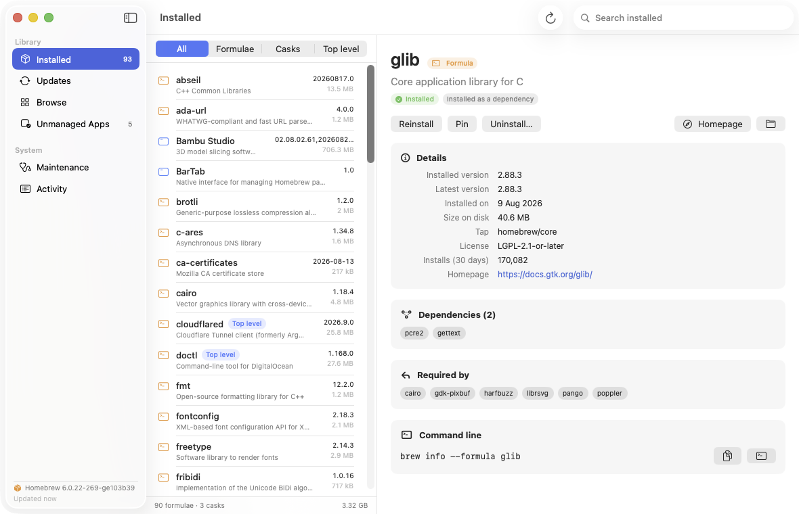

# BarTab

A native macOS app for Homebrew: see what's installed, what has updates, and
browse the full catalogue of formulae and casks to install something new.




## Install

```bash
brew install --cask m4ttyj/tap/bartab
```

The tap is added for you — there's no separate `brew tap` step. BarTab is signed
with a Developer ID certificate and notarized by Apple, so it installs without
Gatekeeper warnings.

Updating and removing work as they do for any cask:

```bash
brew upgrade --cask bartab
brew uninstall --cask bartab
```

Add `--zap` to the uninstall to also delete BarTab's preferences and its cached
copy of the package catalogue.

You can also [download the latest release](https://github.com/m4ttyj/BarTab/releases/latest)
and drag BarTab to your Applications folder, though you'll still need Homebrew
itself installed for the app to have anything to manage.

## What it does

**Installed** — every formula and cask on your Mac with its version, description
and size on disk. Filter by formulae, casks, or "top level" (the things you asked
for, as opposed to the dependencies they dragged in). The footer totals your
Homebrew disk usage.

**Updates** — everything `brew outdated` reports, showing installed → available
versions. BarTab refreshes Homebrew's package definitions for you shortly after
launch and then re-checks, so the list is current without running `brew update`
and `brew outdated` by hand. That happens at most once an hour, is skipped while
another command is running, and is retried next launch if it fails; turn it off
under Maintenance → Update Homebrew. Upgrade one package or all of them. Pinned formulae are marked and
skipped. A checkbox adds casks that update themselves (Chrome, Slack…), which
brew hides by default.

**Browse** — all ~16,000 formulae and casks, searched by name and description and
ranked by how many people installed them in the last 30 days. Empty search shows
the most popular packages.

**Package detail** — version, install date, size, tap, licence, install counts,
homepage, caveats, and both directions of the dependency graph: what it needs,
and what you have installed that needs it. Dependency names are clickable.

**Unmanaged Apps** — scans `/Applications` and `~/Applications` for apps you
installed by hand and matches them against Homebrew's cask list, so brew can
"adopt" them and handle updates from now on. Each match shows whether adoption
will actually work:

- **Ready to adopt** — either your version matches the cask, or the cask is
  marked self-updating (in which case `--adopt` skips its version check
  entirely). Your copy stays where it is; brew just starts tracking it.
- **Version differs** — brew only adopts an identical copy, so it will refuse.
  It fails safely and leaves your app alone; the pane offers the destructive
  `--force` replacement as an explicit, confirmed alternative.
- **From the App Store** — excluded, because the App Store would keep updating
  the same bundle behind brew's back.

Matches are made on the app bundle's file name, which is exactly the key
Homebrew itself uses, and confirmed against the bundle identifier when the cask
declares one in its uninstall stanza. Where several casks claim a name
(`1password`, `1password@beta`, `1password@nightly`), the one with a confirmed
bundle ID, then a matching version, then no `@` suffix wins.

Every control has a hover tooltip saying what it does, and destructive or
long-running ones name the exact brew command they'll run.

### App Management permission

macOS 13 and later require the **App Management** permission before one app can
modify another that's already installed, and every cask operation that touches
an installed app needs it. Because `brew` runs as a child of BarTab, macOS
attributes the attempt to BarTab — so the permission has to be granted to
BarTab, not to your terminal.

BarTab checks for it the way Homebrew does, by attempting a real write inside an
app bundle (there's no API to query it, and the attempt is also what makes macOS
prompt). The check runs once local state loads, and only when you actually have
a cask installed — there's no point asking a formulae-only user for it.

When it's missing you get a notice in the Unmanaged Apps and Updates lists, a
full explanation on any installed cask's detail pane, and a button straight to
Privacy & Security → App Management. Updates only warns when an outdated *cask*
is waiting; formulae live in the Cellar and are unaffected. Nothing is blocked —
without the permission Homebrew may still succeed by deleting and reinstalling
the app instead of taking over your copy, and the banner says so, since that
trade-off is yours to make.

**Maintenance** — `brew doctor`, `brew cleanup` (with a dry run first, so you can
see how much space you'd reclaim), `brew autoremove`, and `brew update`.

**Activity** — every command the app runs, one at a time, with live streaming
output, exit status, timing, and a cancel button.

## Requirements

- macOS 14 or later
- Homebrew installed at `/opt/homebrew` or `/usr/local` (or anywhere on your
  login shell's `PATH`)

## Build

Building from source additionally needs the Xcode command line tools.

```bash
./scripts/build-app.sh            # release build into ./build
./scripts/build-app.sh --run      # …and launch it
./scripts/build-app.sh --install  # …and copy it to /Applications
```

Other flags: `--debug` for a faster unoptimised build, `--universal` for an
arm64 + x86_64 binary.

The script produces `build/BarTab.app`, ad-hoc signed so it launches locally.
The hardened runtime is applied to local builds as well as release ones, so a
build you test behaves exactly like a build you ship. You can also open
`Package.swift` in Xcode and run the `BarTab` scheme, though that runs the bare
executable without the bundle's icon.

## Distribution

BarTab cannot go to the Mac App Store. Store apps must be sandboxed, and the
sandbox denies both reading the Homebrew prefix and executing a binary outside
the app bundle — which is the whole app. A sandboxed build can't even find
`brew`, let alone run it, and no entitlement changes that.

Developer ID signing plus notarization is the route, and it's the one every
other Homebrew GUI takes. The hardened runtime that notarization requires does
not interfere with launching brew: it restricts library injection, JIT and
`DYLD_*` variables, not child processes.

```bash
./scripts/build-app.sh --sign      # Developer ID + hardened runtime
./scripts/build-app.sh --notarize  # …then notarize, staple, and zip for release
```

`--notarize` submits the app, waits for the verdict, prints the notary log if it
fails, staples the ticket, runs a Gatekeeper assessment, and writes
`build/BarTab-<version>.zip`. The archive is created *after* stapling, since the
ticket lives inside the bundle and an earlier archive would ship unnotarized.

Both flags check their prerequisites before building, so a missing certificate
fails in a second rather than after a full compile.

### One-time setup

1. **A Developer ID Application certificate.** Create it at
   [developer.apple.com](https://developer.apple.com/account/resources/certificates),
   then download and double-click to install. An *Apple Development*
   certificate only signs for local use and an *Apple Distribution* certificate
   is for the App Store — neither can be notarized for outside distribution.
   The script finds the right one automatically, or name it with
   `--sign="Developer ID Application: You (TEAMID)"`.
2. **Notary credentials in your keychain**, stored once:

   ```bash
   xcrun notarytool store-credentials "bartab-notary" \
     --key ~/private_keys/AuthKey_XXXXXXXX.p8 --key-id XXXXXXXX --issuer <issuer-uuid>
   ```

   An app-specific password works too: `--apple-id`, `--team-id`, `--password`.
   Use a different profile name with `--notarize=<profile>`.

`BARTAB_SIGN_IDENTITY` and `BARTAB_NOTARY_PROFILE` act as defaults for both.

Once notarized, the natural home for it is a Homebrew cask of its own —
`brew install --cask bartab` — which is how Cork and Applite ship.

## How it works

The app shells out to your real `brew` — it never reimplements package
management, so anything it does is something you could have typed yourself, and
the exact command is always visible in the Activity log and on each package's
detail pane.

| Concern | Approach |
| --- | --- |
| Reading local state | `brew info --json=v2 --installed` and `brew outdated --json=v2`, parsed once into value types |
| Disk usage | A single `du -k -d 1` pass over `Cellar` and `Caskroom` rather than 90 directory walks. The Caskroom pass adds `-L`, because every cask install ends by symlinking its Caskroom entry to the app in `/Applications` — without it every cask measures a few kilobytes |
| Browsing | `formulae.brew.sh` JSON API, reduced to the fields the UI needs and cached in `~/Library/Application Support/BarTab/catalog.json` for 12 hours |
| Popularity | The 30-day install analytics endpoints |
| Running commands | One at a time — Homebrew takes a global lock, so concurrent installs just fail confusingly. Output is streamed line by line, treating `\r` as a break so progress bars appear |
| Environment | A GUI launched from Finder inherits no shell `PATH`, so `BrewEnvironment` reconstructs one and sets `HOMEBREW_NO_AUTO_UPDATE`, `HOMEBREW_NO_COLOR` and friends |
| Adoption | App `Info.plist` versus each cask's `app` artifact names, `auto_updates` flag and declared bundle identifiers. `AdoptionMatcher.readiness` mirrors what `Cask::Artifact::Moved#move` actually does with `adopt:` |

### Passwords

A handful of casks run installers that need `sudo`. The app deliberately can't
answer that prompt — it sets `SUDO_ASKPASS=/usr/bin/false` so the command fails
fast instead of hanging, detects the password prompt in the output, and offers a
**Run in Terminal** button that opens the exact command in Terminal.app where you
can type your password yourself. Every package detail pane has the same escape
hatch.

The app is not sandboxed, because it has to execute `brew` and read the Homebrew
prefix.

## Layout

```
Package.swift
Sources/BarTab/
  BarTabApp.swift            @main, window, menu commands
  Models/Models.swift        value types for packages, catalogue entries, reports
  Services/
    BrewEnvironment.swift    locating brew, building a sane child environment
    CommandRunner.swift      Process wrapper: capture + line streaming, ANSI stripping
    BrewService.swift        installed / outdated / sizes / doctor / cleanup
    CatalogService.swift     formulae.brew.sh download, slimming and caching
    JSONHelpers.swift        small reader over brew's loosely-typed JSON
    AppScanner.swift         finds apps outside brew and matches them to casks
  State/
    AppModel.swift           observable root store, derived lists, actions
    OperationCenter.swift    serial queue of brew commands with live logs
  Views/                     one file per section, plus shared components
Resources/AppIcon.{svg,icns}
scripts/build-app.sh
```

## Licence

MIT — see [LICENSE](LICENSE).

Not affiliated with the Homebrew project. "Homebrew" is a trademark of the
Homebrew project; this app drives the `brew` command line tool and is not
endorsed by or associated with it.
